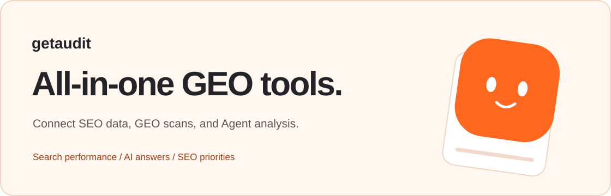
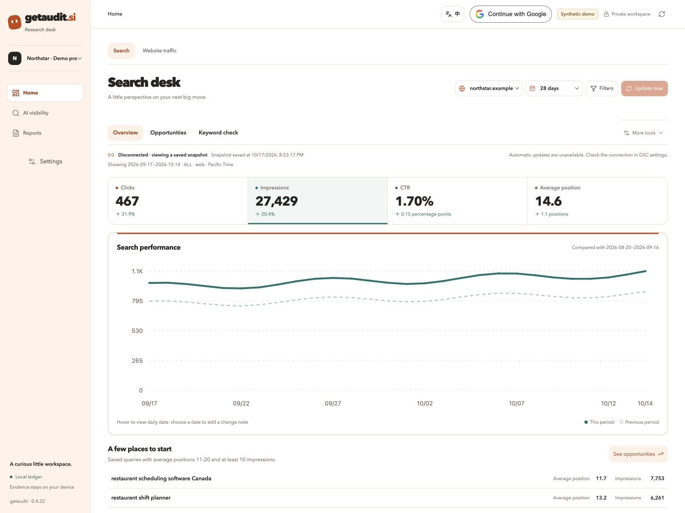

<p align="center">
  
</p>

<p align="center">
  <strong>An integrated SEO and GEO system for your local workspace.</strong><br>
  English · <a href="README.zh-CN.md">简体中文</a>
</p>

> **Early-access source release · MIT.** Integration code is included; configure your own accounts and credentials. No production credentials, customer records, or original development Git history are included.

## Meet getaudit

getaudit brings search data, local GEO scans, and Agent analysis into one desktop workspace. Connect your Google data and run configured scans across supported AI platforms. Give a compatible Agent access to selected findings to help prioritize your next SEO improvements.



*Actual getaudit interface. Synthetic example data. These figures are not customer results or a live ranking check.*

## What you get

### SEO: connect your search and traffic data

Use your Google account to connect Google Search Console (GSC) and Google Analytics 4 (GA4). Review search queries, page performance, and website traffic within your project to investigate which areas need attention. GSC average positions describe a reporting window; they are not a fresh live rank check.

Google Search Console and GA4 are the current SEO data integrations. The combined Google sign-in and GA4 workflow are still in testing. **Bing Webmaster Tools and other data connections are planned.**

### GEO: scan supported AI platforms from your Mac

Run getaudit locally, configure the platforms and research conditions, and start a multi-platform GEO scan. Review captured answers, brand mentions, and citations alongside the conditions under which they were collected. Blocked or incomplete attempts remain visible.

Your project keeps the collected answers, citations, research records, and reports in local storage. Platform access, region, login requirements, and rate limits still affect what can be captured.

### Agent analysis: turn saved findings into your next SEO priorities

Authorize a compatible third-party Agent to read selected SEO/GEO findings and evidence context from your project. Use its analysis to investigate which pages to improve, which questions need coverage, and what to check next. Review the recommendations before making changes.

The current Agent interface provides selected GSC and GEO context. It does not expose GA4, full GEO answer text, or raw capture files. Saving an Agent's analysis back to the project requires a separate permission.

## How the workflow fits together

1. **Set up your project.** Choose your website, Google properties, research questions, and supported platforms.
2. **Collect and review.** Bring in authorized search data and run configured GEO scans from your computer.
3. **Choose what the Agent can read.** Grant access to selected saved findings for analysis; keep the original evidence available in the app.
4. **Plan the next improvements.** Review the suggestions, prioritize SEO work, and collect fresh evidence when you are ready to compare.

Your work is saved locally. Google reads, AI-platform scans, and optional provider calls still contact their respective services. Evidence you authorize an external Agent to read can leave your device for analysis.

The interface supports English and 简体中文 in one click. Supported jobs can continue in the background while the app is running; quitting, sleep, or shutdown can interrupt them. Reports and evidence exports keep sources and collection conditions attached, so you can return to the basis of a finding.

## Try the local demo

Use **Node.js 22.19 or newer** and npm. macOS is the current desktop target; other native platforms have not been validated.

From the repository root:

```sh
npm ci
npm run console:build
npm run console:demo
```

Open the loopback URL printed in the terminal. The demo seeds a separate local database with fictional records and needs no provider credentials. It does not make paid collection calls automatically.

For an empty local workspace:

```sh
npm run console
```

For the development desktop window on macOS:

```sh
npm run desktop:dev
```

The community desktop build uses its own application identity and data directory. It does not open another installed edition's connection vault. This repository contains source, not a signed or notarized public installer.

## Connections and current limits

| Capability | What to expect |
| --- | --- |
| Local demo, question library, evidence inspection, exports | Available without bundled account credentials. Demo records are synthetic. |
| Browser-based collection | Platform, region, session, rate limits, and CAPTCHA affect availability. Strict guest mode does not promise every platform's full answer or citations. |
| Optional model and data APIs | Integration source is included. Supply your own credentials explicitly; third-party usage can cost money. No owner keys or paid account entitlements are shared. |
| Google Search Console | Read-only connection and analysis code are included. Your account must authorize its own properties. |
| Google sign-in and GA4 | Integration is in validation. Register your own Google Cloud Desktop OAuth client for a self-built app. This is not a Google-verified public client or a claim of completed end-to-end GA4 validation. Ordinary app users should follow the Google sign-in flow, not paste authorization codes. |
| Bing Webmaster Tools | Planned SEO data connection. This is separate from the supported Microsoft Copilot GEO collection surface. |
| Third-party Agent access | Selected saved GSC/GEO findings and evidence context. GA4 and raw GEO answers/captures are outside this interface; saving an analysis requires separate permission. |
| Background jobs | Run while the application is open; this is not an operating-system daemon. |

Local storage does not make external research offline: provider requests, browser collection, and connected Google reads contact the selected services. The demo is the place to explore without configuring them.

## What is in the source

```text
apps/console/    English-first React interface and Chinese translations
desktop/        Electron shell and browser collectors
src/            Evidence ledger, connectors, analysis, reports, and CLI
tests/          Automated tests with synthetic fixtures
scripts/        Build, locale, and local review tools
website/        Bilingual showcase website and privacy-policy template
docs/           Setup, evidence boundaries, and required third-party notices
```

The SEO/GEO research and audit core is free and open source, including AI mention/citation measurement, search analysis, competitor research, keyword matrices, scoped agent access, and evidence export. Not every planned workflow is implemented. Future content-writing or publishing products are outside this repository's current promise. Third-party service charges remain separate.

## Build and check

```sh
npm run typecheck
npm run console:typecheck
npm run check:locales
npm test
npm run console:build
npm run website:build
npm run review:scan
```

The showcase has its own [setup notes](website/README.md). Its origin, operator, and contact fields are placeholders; its privacy policy is a template for the eventual operator, not a representation that another person's deployment is covered.

## Keep your clues private

Keep databases, answer captures, analytics exports, logs, browser sessions, OAuth metadata, tokens, signing material, and real customer fixtures outside Git. The supplied ignore rules and review scanner are guardrails, not permission to commit those files.

Only synthetic examples belong in public tests, screenshots, and issues. See [SECURITY.md](SECURITY.md), [CONTRIBUTING.md](CONTRIBUTING.md), and [the release boundary](docs/RELEASE_REVIEW.md).

## License

Project source: [MIT License](LICENSE). Third-party components, the bundled font, and retained upstream legal material keep their own licenses and required attribution; see [THIRD_PARTY_NOTICES.md](THIRD_PARTY_NOTICES.md).
